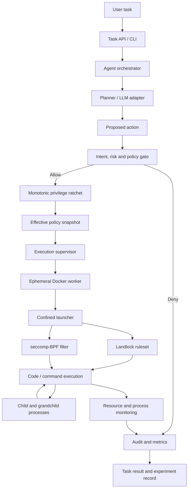
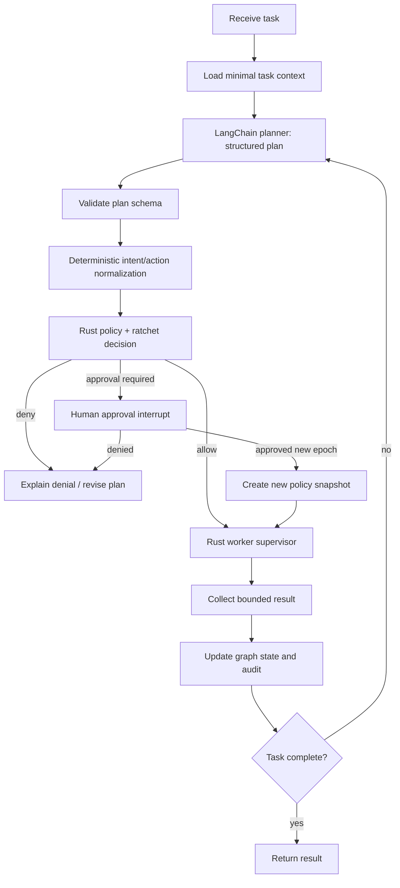
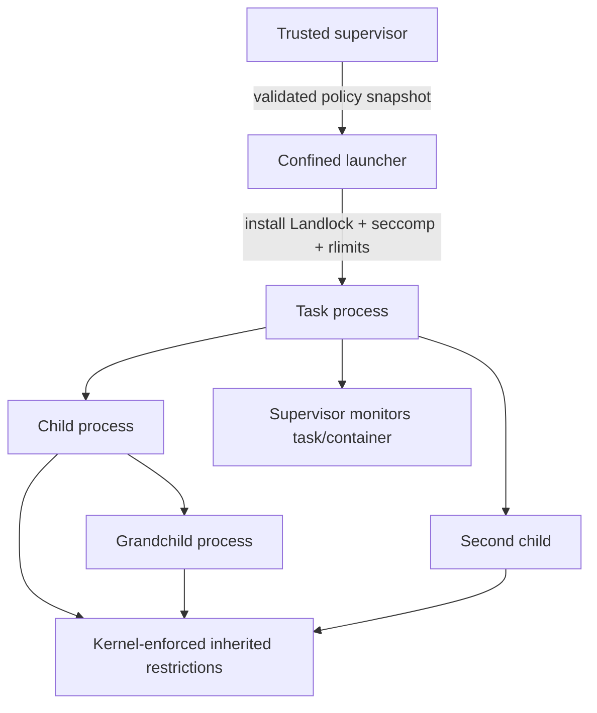

# System Architecture

## 1. Project identity

**Project:** Ratcheted, Subprocess-Aware Privilege Confinement for Code-Executing Agents  
**Research goal:** Determine experimentally whether task-scoped least-privilege policies, a monotonic privilege ratchet, and Linux kernel confinement can reduce unauthorized actions by code-executing AI agents while preserving legitimate coding-task completion at acceptable overhead.

This architecture follows the RV College of Engineering 2026-27 project synopsis. The synopsis identifies the primary controls as a JSON-based task policy, a monotonic privilege ratchet, Linux Landlock filesystem restrictions, seccomp-BPF system-call filtering, and Docker isolation. It also requires comparison against an unconstrained test baseline and conventional sandboxing without the ratchet layer.

## 2. Architectural principles

1. **Least privilege at task start.** Every task receives an explicit policy. Missing permissions are denied rather than inferred from the model's intent.
2. **Monotonic restriction within an execution epoch.** During one execution epoch, effective permissions may stay the same or become narrower. They cannot be silently restored.
3. **Kernel enforcement is authoritative.** Model reasoning and tool-call validation are useful control layers, but they are not substitutes for OS-enforced restrictions.
4. **Descendants stay confined.** The worker applies Landlock and seccomp before executing untrusted task code. Child processes inherit the restrictions installed by the kernel, subject to the kernel/API configuration and thread model.
5. **Fail closed.** If required confinement cannot be installed or verified, the protected execution must not start. An explicitly labelled non-confined diagnostic mode may exist only for tests and must never be selected implicitly.
6. **Separate control plane from execution plane.** The policy engine and audit store are trusted components. Generated code and repository contents are untrusted inputs.
7. **Measure utility and overhead as well as security.** A secure system that blocks normal coding work is not a successful result.
8. **Reproducibility.** Policies, image digest, kernel version, scenario version, random seed, and run configuration are recorded with each experiment.

## 3. Scope and non-goals

### In scope

- A provider-independent code-executing agent interface.
- Task-scoped JSON policy representation and schema validation.
- Policy decision and privilege-ratchet engine.
- Command/action mediation for agent tool calls.
- Per-task execution workspace and process supervision.
- Landlock filesystem confinement and seccomp-BPF system-call filtering.
- Docker as an additional repeatable isolation boundary.
- Process-tree and subprocess tests.
- Structured audit logs and experiment comparison.
- Legitimate coding tasks, prompt-injection scenarios, staged privilege-escalation attempts, and suspicious subprocess scenarios.

### Explicit non-goals for the first prototype

- Proving that prompt injection can never succeed.
- Providing a production multi-tenant hosted execution service.
- Treating Docker alone as a complete security boundary.
- Allowing arbitrary network access or package installation during protected execution by default.
- Enforcing arbitrary executable-path or command-string policies using seccomp alone. Seccomp filters system calls and arguments; it cannot safely dereference arbitrary userspace pointers such as the pathname string passed to `execve`.
- Claiming kernel-level enforcement for a rule that is only checked by the agent/tool broker.
- Supporting every Linux distribution, architecture, kernel version, language runtime, or filesystem in the first release.

## 4. High-level architecture



The diagram separates policy decisions from kernel enforcement. The planner proposes actions; it does not grant permissions. The ratchet computes the effective policy. The supervisor starts the execution worker. The kernel controls what the worker and its descendants can access.

## 5. Components and responsibilities

| Component | Responsibility | Trust level | Required behavior |
|---|---|---|---|
| Task API / CLI | Accept task, policy, workspace input and run options | Trusted | Validate request size, identity, policy version and task lifecycle |
| Agent orchestrator | Python + LangGraph state machine; LangChain model/tool abstractions | Trusted but exposed to untrusted model output | Treat model output as data; never execute a raw model response without validation |
| Planner / LLM adapter | Produce a plan, code changes and proposed tool actions | Untrusted output | May use any provider; must not directly access the host or bypass the execution supervisor |
| Intent/risk gate | Classify proposed actions against task intent and policy | Trusted decision logic | Return allow, deny, or approval-required with reason and policy evidence |
| Policy validator | Rust authoritative validator; Python performs boundary/schema checks only | Trusted | Reject unknown fields, unsafe paths, malformed limits and unsupported rights |
| Privilege ratchet | Rust deterministic core called by the Python controller | Trusted security-critical component | Enforce subset invariant; Python cannot override its result |
| Execution supervisor | Rust process supervisor + narrow Python Docker/controller adapter | Trusted security-critical component | No Docker socket or host secrets are exposed to task code |
| Confined launcher | Rust native binary installs Landlock and seccomp before `exec` | Security-critical low-level component | Verify successful installation; fail closed on required-control failure |
| Docker worker | Add namespaces, cgroups, image isolation and resource limits | Additional boundary | Run non-root, drop capabilities, no-new-privileges, read-only root, no network by default |
| Process/resource monitor | Track exit status, process tree, time and resource use | Trusted observer | Detect timeout, runaway descendants and resource exhaustion |
| Audit/event store | Store policy decisions, denials, process events and metrics | Trusted | Append-only event semantics; do not store secrets or full sensitive file contents |
| Evaluation harness | Execute the same scenarios across experiment arms | Trusted test infrastructure | Preserve comparable workloads and record environment metadata |


## 5A. Adopted implementation stack: Python + LangChain/LangGraph + Rust

This is the authoritative implementation decision for the prototype. It refines the original synopsis methodology without changing the research question or security controls.

| Layer | Technology | Responsibility | Security boundary |
|---|---|---|---|
| Agent/controller | Python 3.12+ | Task intake, model integration, context preparation, user-facing API/CLI | Trusted orchestration, but model output and retrieved repository content remain untrusted |
| Agent construction | LangChain | Chat-model adapters, prompt templates, structured output schemas, tool interfaces | LangChain tools are proposal interfaces only; no privileged tool bypass |
| Agent orchestration | LangGraph | Explicit state graph, deterministic gates, retries, checkpoints and human approval interrupts | Graph routing is workflow control, never the authoritative permission decision |
| Policy and ratchet | Rust workspace | JSON policy parsing/validation, canonicalization, subset checks, authorization and policy versioning | Trusted security-critical component; deterministic and independently tested |
| Native launcher/supervisor | Rust | Landlock, seccomp-BPF, `no_new_privs`, rlimits, process lifecycle and worker launch | Trusted security-critical component; fail closed |
| Worker | Minimal Docker image(s) | Execute approved code/commands and descendants | Untrusted execution plane; no LLM credentials, Docker socket or controller secrets |
| Evaluation | Python | Scenario generation, experiment orchestration, statistics and reports | Trusted test harness; does not weaken production enforcement |

### LangGraph agent graph

Implement a deliberately constrained graph, not an unrestricted ReAct agent with direct shell access:



Required graph nodes: `intake`, `context_loader`, `planner`, `plan_validator`, `action_normalizer`, `policy_decision`, `approval_interrupt`, `worker_dispatch`, `result_collector`, `completion_check`, and `finalize`. The planner may propose actions only. The Rust policy engine must independently validate each action against the current effective policy before dispatch.

### LangChain/LangGraph security and privacy rules

- Use typed Pydantic/JSON schemas for planner output; reject unknown fields and malformed actions.
- Do not expose generic shell, Docker, filesystem-root, policy-write, ratchet-write or arbitrary network tools to the model.
- Expose narrow tools such as `read_workspace_file`, `propose_patch`, `run_approved_test`, and `request_permission`; every tool call is routed through the policy gate and Rust supervisor.
- Keep deterministic security decisions in ordinary code/Rust. Never ask the LLM whether a policy expansion is safe or whether an operation is authorized.
- LangGraph checkpoints must store only the minimum state required. Exclude API keys, raw secrets, full sensitive file contents and privileged host paths. Apply redaction before persistence.
- Use local SQLite checkpoints for development/evaluation if persistence is needed. PostgreSQL is optional for a deployed multi-user service; do not add it solely for the prototype.
- LangSmith tracing is **off by default**. Enable only after reviewing data handling and configuring input/output redaction; never send secrets, private repository contents or worker output containing sensitive data to hosted tracing.
- Keep model calls outside the disposable worker. The worker has no LLM API credentials and no direct LangChain/LangGraph runtime.
- Pin dependency versions and record Python, LangChain, LangGraph, Rust toolchain, crate, kernel and Docker image versions in each run manifest.

### Rust implementation guidance

Use a Cargo workspace with separate crates such as `policy-model`, `policy-validator`, `privilege-ratchet`, `linux-confinement`, `execution-launcher`, `process-supervisor`, and `protocol`. Prefer safe, maintained abstractions (for example, the Rust `landlock` crate) and isolate any raw syscall/libc usage in the smallest possible module. For seccomp, evaluate a maintained Rust seccomp crate or a narrowly scoped libseccomp binding; document the chosen API and kernel compatibility. Do not assume crate availability means the configuration is correct: test the effective kernel behavior.

## 6. Trust boundaries and data flow

### Boundary A: User / repository content to planner

Treat user prompts, source code, comments, README files, issue descriptions, package metadata, test fixtures, compiler output and retrieved content as potentially adversarial. Prompt injection may be direct or indirect. Instructions found inside a repository do not override the task policy.

### Boundary B: Planner to policy gate

Planner output is an untrusted proposal. The gate validates each proposed action against the user's task, the policy, the current ratchet state and any required human approval. Do not allow the model to write the effective policy file directly.

### Boundary C: Trusted supervisor to worker

The supervisor passes only a task workspace, a validated effective policy snapshot, an explicit command/action request, and bounded input data. Do not mount the host home directory, host root, Docker socket, SSH agent socket, cloud credentials, browser profile, or arbitrary host paths into the worker.

### Boundary D: Worker to host

Only explicitly exported output artifacts and bounded logs may cross back. Validate output archive entries; reject absolute paths, `..` traversal, symlinks, hard links, devices, FIFOs and unexpected file types. Never trust a filename or archive member supplied by task code.

## 7. Policy model

The policy is a declarative ceiling for a task. It is not a natural-language instruction and is not authored by the model at runtime. It is validated against a versioned schema before execution.

### 7.1 Example policy

```json
{
  "schema_version": "1.0",
  "task_id": "task-2026-001",
  "description": "Implement and test a small Python function",
  "workspace": "/workspace/task",
  "filesystem": {
    "read_only": ["/usr", "/lib", "/lib64"],
    "read_write": ["/workspace/task", "/tmp"],
    "deny": ["/etc/shadow", "/root", "/home"]
  },
  "commands": {
    "allowed_tool_names": ["read_file", "write_file", "apply_patch", "run_tests", "run_command"],
    "allowed_executables": ["/usr/bin/python3", "/usr/bin/pytest", "/usr/bin/gcc"],
    "shell": "deny"
  },
  "syscalls": {
    "profile": "python-build-v1",
    "deny_high_risk": ["mount", "umount2", "ptrace", "bpf", "kexec_load", "init_module", "finit_module", "delete_module", "reboot", "setns", "unshare"]
  },
  "network": {
    "mode": "none",
    "allowed_tcp_ports": [],
    "allowed_udp_ports": []
  },
  "limits": {
    "wall_time_seconds": 60,
    "cpu_seconds": 45,
    "memory_bytes": 536870912,
    "file_size_bytes": 52428800,
    "process_count": 32,
    "open_files": 128
  },
  "approval": {
    "required_for_privilege_step_up": true,
    "approval_mode": "new_execution_epoch"
  }
}
```

The sample is illustrative, not a universal profile. The implementation must maintain a JSON Schema and validate paths, commands, syscall profiles and numeric limits against host capabilities. The `deny` list is an explicit policy intent; it must not be presented as a kernel guarantee unless the relevant control actually enforces it.

### 7.2 Policy semantics

- **Read-only paths:** the worker may read the allowed hierarchy, subject to the Landlock rights that are supported and handled by the running kernel.
- **Read-write paths:** the worker may perform only the selected filesystem operations within these hierarchies.
- **Denied paths:** explicit deny rules are defense in depth. A deny path must not be shadowed by a broader allow rule.
- **Command/tool names:** checked by the tool broker before a command is started. This is not a substitute for kernel isolation against arbitrary code already running inside an interpreter.
- **Syscall profile:** a versioned seccomp profile, with documented allow/deny semantics.
- **Network:** `none` is the default. Port-level Landlock network restrictions, where supported, are not IP-address allowlists. Network access must remain off unless the experiment explicitly evaluates it.
- **Limits:** validated against configured host/container ceilings. A task cannot request a larger limit than the deployment maximum.

## 8. Monotonic privilege ratchet

Let `P0` be the validated initial policy and `E_n` be the effective permission set at transition `n`. Permissions are represented as normalized capabilities, including filesystem rights per path, command/tool rights, network rights, syscall profile constraints and resource ceilings.

For every in-epoch update:

```text
E_(n+1) subset_of E_n
```

A requested transition that adds any permission is rejected and logged as `PRIVILEGE_EXPANSION_DENIED`.

### 8.1 Permission ordering

The policy engine must normalize permission sets before comparing them. Examples:

- Removing a writable path is a restriction.
- Changing a path from read-write to read-only is a restriction.
- Removing an allowed executable/tool is a restriction.
- Disabling network is a restriction.
- Lowering CPU, memory, wall-clock, file-size, process or open-file ceilings is a restriction.
- Adding a syscall denial is a restriction.
- Expanding a path, adding a tool, enabling network, increasing a limit or weakening a syscall profile is an expansion.

The implementation must define path containment semantics carefully (`/workspace/a` must not accidentally match `/workspace/ab`). Normalize paths, reject traversal and symlink escapes, and resolve workspace roots before policy comparison.

### 8.2 Explicit step-up decision

The synopsis says privilege expansion must not be silently granted and requires explicit authorization. To preserve the ratchet invariant, the recommended first-release behavior is:

1. Pause the task when additional permissions are requested.
2. Record the requested delta and why it is needed.
3. Require explicit human authorization outside the model output.
4. End the current execution epoch.
5. Start a new epoch with a newly validated policy and a fresh worker/container.
6. Record the approver, scope, reason, timestamp and policy hashes.

This avoids silently broadening an already-running process tree. An in-place step-up mode should be considered a separate experiment and must never be the default.

## 9. Kernel confinement design

### 9.1 Landlock

Landlock provides unprivileged, stackable access-control rules for selected filesystem operations and, in newer ABIs, selected network operations. The launcher should:

1. Probe Landlock support and the ABI version at runtime.
2. Determine which access rights the running ABI supports.
3. Build a ruleset with an explicit handled-rights mask.
4. Add narrow rules for the workspace and required runtime paths.
5. Set `PR_SET_NO_NEW_PRIVS` where required by the chosen confinement sequence.
6. Restrict the worker before untrusted code is executed.
7. Record ABI version, handled rights and successful rule application.

Landlock restrictions are inherited by new threads/processes created by a restricted thread. Apply the domain before starting untrusted threads or subprocesses. If the launcher uses a multi-threaded process, account for thread synchronization semantics and the Landlock ABI's thread-synchronization support. Do not assume an already-running sibling thread is retroactively confined.

Important limitations must be documented: Landlock only controls access rights included in the handled mask; older ABIs do not support newer rights; special kernel interfaces and some `/proc`-related paths have limitations; Landlock does not by itself prevent all forms of process execution or network communication.

### 9.2 seccomp-BPF

The launcher should install a seccomp filter before executing task code. Filters must be designed for the selected runtime/profile and tested for compatibility. The filter should at minimum deny dangerous system-call surfaces that are not needed by the worker, such as kernel module operations, kernel reboot, namespace manipulation, mount operations and process inspection/debugging operations where appropriate.

For stronger profiles, use a default-deny allowlist for the exact runtime and workload. Keep profiles versioned and separate by workload. A broad denylist is a useful initial compatibility profile, but must be described as defense in depth rather than a complete syscall allowlist.

Call `PR_SET_NO_NEW_PRIVS` before installing an unprivileged seccomp filter. Ensure `fork`/`clone` and `execve` behavior is intentional: descendants inherit installed filters when the relevant calls are allowed. Never add `CAP_SYS_ADMIN` merely to make filter installation convenient.

### 9.3 Docker outer boundary

Every protected task runs in an ephemeral worker container with a pinned image digest. Recommended defaults:

- Run as a non-root UID/GID.
- Drop all Linux capabilities.
- Set `no-new-privileges`.
- Retain Docker's default seccomp profile unless a reviewed custom profile is necessary.
- Use a read-only container root filesystem.
- Provide only bounded task scratch space, preferably a size-limited `tmpfs` for initial experiments.
- Disable network access by default (`network none`).
- Set memory, CPU, PID, file-size and open-file limits.
- Do not use `--privileged`, host PID, host network, host IPC or broad host bind mounts.
- Never mount `/var/run/docker.sock` into the task worker.
- Do not add `SYS_ADMIN`, `SYS_PTRACE`, `SYS_MODULE`, `NET_ADMIN` or other capabilities as a shortcut.

Docker is an additional isolation layer, not proof that arbitrary hostile code cannot escape. Host kernel, Docker daemon, runtime and configuration remain part of the trusted computing base. Prefer rootless Docker where operationally feasible and test the actual host configuration.

## 10. Subprocess-aware execution model



Key requirements:

- Apply restrictions in the process that is about to `exec` the task program, not merely in a separate parent process that later launches an unrestricted child.
- Install restrictions before any untrusted instruction is executed.
- Keep all task descendants inside the same worker container/cgroup and process namespace.
- Set a bounded process count and use a reliable whole-container/whole-cgroup termination path for timeout or cancellation.
- Track descendant PIDs for audit, but do not use PID tracking as the only enforcement mechanism.
- Verify inheritance using child, grandchild, shell, interpreter, fork, clone and exec test cases.
- Treat `setsid`, daemonization and background subprocess behavior as explicit test cases.

## 11. Agent execution interface

The planner/LLM adapter is provider-agnostic. It returns structured proposals, not executable authority.

Suggested tool surface:

| Tool | Input | Policy check | Result |
|---|---|---|---|
| `list_files` | Relative path | Read permission and workspace containment | Bounded directory listing |
| `read_file` | Relative path, byte range | Read permission, file size cap | File text or binary metadata |
| `write_file` | Relative path, content | Write permission, path containment, size cap | Write result |
| `apply_patch` | Relative path, patch | Read + write permission, patch size cap | Patch result |
| `run_command` | Executable ID, argument array, cwd | Tool/executable policy, resource limits, current ratchet | Exit code and bounded output |
| `run_tests` | Test target | Test command policy | Test report |
| `request_permission` | Requested capability and reason | Always pauses; cannot self-approve | Approval-required or denied |

Never build shell strings by concatenating model-produced values. Prefer argv arrays with `execve`/`subprocess` argument lists and `shell=False`. If a shell tool is enabled for a specific experiment, mark it as a higher-risk capability and test it separately.

## 12. Audit and observability

Every run should emit structured JSONL events. Suggested common fields:

```json
{
  "event_id": "uuid",
  "timestamp_utc": "2026-11-02T00:00:00Z",
  "run_id": "run-001",
  "task_id": "task-001",
  "epoch": 1,
  "scenario_id": "PI-003",
  "component": "policy_gate",
  "event_type": "ACTION_DENIED",
  "decision": "deny",
  "reason_code": "PATH_OUTSIDE_WORKSPACE",
  "policy_version": "1.0",
  "policy_hash": "sha256:...",
  "process_id": 123,
  "parent_process_id": 120,
  "action": "read_file",
  "resource": "/etc/shadow",
  "duration_ms": 1
}
```

Events should include at least: task started/completed, policy validated, policy transition accepted/rejected, permission expansion requested/denied/approved, kernel confinement installed/failed, command started/finished, process spawned/terminated, resource limit hit, filesystem denial, syscall denial where observable, timeout, cancellation, export accepted/rejected, and experiment result.

Do not log API keys, passwords, access tokens, complete secret file contents or private user data. Redact command arguments when they may contain secrets.

## 13. Failure handling

| Failure | Required response |
|---|---|
| Invalid policy/schema | Reject before starting the worker |
| Requested permission expansion | Pause/deny; require explicit external authorization and new epoch |
| Landlock unavailable or required rule fails | Fail closed for protected mode; record capability failure |
| seccomp filter installation fails | Fail closed for protected mode |
| Docker unavailable or image digest mismatch | Do not fall back to host execution |
| Workspace path escape/symlink escape | Deny and log |
| Resource limit or timeout | Kill the complete worker/container; preserve bounded evidence |
| Audit storage unavailable | Do not silently run unaudited protected tasks; configurable fail-closed mode |
| Worker exits unexpectedly | Mark incomplete, collect safe logs, do not assume success |
| Export contains unsafe archive entries | Reject export and record details |

## 14. Experimental deployment modes

The evaluation harness must support the following arms. The outer host must remain safe in all arms; the “unconstrained” condition means unconstrained at the project task-policy/kernel layer inside an isolated disposable test worker, not unrestricted execution on a developer's host.

| Arm | Description | Purpose |
|---|---|---|
| B0 - Isolated unconstrained baseline | Disposable Docker worker with standard outer container protections; no task-specific ratchet and no project-specific Landlock/seccomp rules | Measure behavior without the proposed controls while retaining a safe test boundary |
| B1 - Sandbox-only baseline | Same worker image and workloads, with static Docker/Landlock/seccomp confinement but no monotonic policy update layer | Isolate the value of the ratchet |
| P1 - Proposed system | Task policy + monotonic ratchet + Landlock + seccomp + Docker + subprocess monitoring | Evaluate the complete design |

All arms must receive equivalent task prompts, repository snapshots, model configuration, tool availability where possible, time budgets and resource ceilings. Record differences that cannot be held constant.

## 15. Key design assumptions to confirm during implementation

1. Linux is the target OS; the first implementation targets one architecture (prefer x86_64) and a documented kernel baseline.
2. **Implementation stack decision (supersedes the synopsis' initial Python-first implementation suggestion):** Python 3.12+ with LangChain and LangGraph is used for the AI controller/orchestration and evaluation harness; Rust is used for the trusted policy/ratchet core, native execution launcher, Linux confinement and process supervision. Python remains a supported untrusted workload runtime inside workers, not the security enforcement implementation language.
3. The first agent adapter may use a deterministic/mock planner so the security framework can be tested independently of an LLM provider.
4. Network access is disabled in protected execution by default.
5. An explicit privilege step-up begins a new execution epoch; in-epoch policy changes only narrow privileges.
6. Docker image, seccomp profile, Landlock ABI and policy versions are pinned and recorded.
7. A finite test catalogue cannot prove absence of all vulnerabilities. Results are claims about the tested configuration and workload classes only.
8. Concrete implementation decisions D1–D9 (OpenAI-compatible planner endpoint, Rust-only worker entrypoint, Python + C runtimes, `ratchetd` UDS daemon, per-action containers, named-volume workspaces) are recorded in `STACK_DECISION.md`. The wire contract is in `protocol.md` and the threat model in `threat_model.md`.

## 16. References

### Project source

- RV College of Engineering, *Ratcheted, Subprocess-Aware Privilege Confinement for Code-Executing Agents*, Experiential Learning Synopsis 2026-27, pp. 2-6.

### Implementation references

- Linux Kernel, Landlock LSM documentation: https://docs.kernel.org/security/landlock.html
- Linux Kernel, Landlock userspace API: https://docs.kernel.org/userspace-api/landlock.html
- Linux Kernel, seccomp filter documentation: https://docs.kernel.org/userspace-api/seccomp_filter.html
- Linux Kernel, `no_new_privs`: https://docs.kernel.org/userspace-api/no_new_privs.html
- Docker, seccomp security profiles: https://docs.docker.com/engine/security/seccomp/
- Docker, Engine security: https://docs.docker.com/engine/security/
- Docker, rootless mode: https://docs.docker.com/engine/security/rootless/
- Docker, resource constraints: https://docs.docker.com/engine/containers/resource_constraints/
- LangChain/LangGraph overview and architecture: https://docs.langchain.com/oss/python/langgraph/overview
- LangGraph workflows and agents: https://docs.langchain.com/oss/python/langgraph/workflows-agents
- LangGraph checkpointing: https://docs.langchain.com/oss/python/langgraph/persistence
- Rust Landlock crate documentation: https://docs.rs/landlock/latest/landlock/
