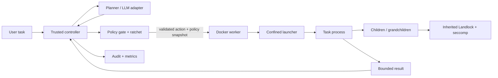

# Build Specification: Docker-Based Code-Execution Agent

## 1. Objective

Build a code-executing agent that can inspect a task workspace, propose code changes, run approved commands/tests and return results while remaining inside a task-specific privilege boundary. The execution component must be isolated in Docker and protected by Linux Landlock and seccomp-BPF before untrusted code starts.

This document is the build contract for the code-execution component. It is intentionally more specific than a general agent design: it defines the control/execution split, interfaces, Docker packaging, launcher behavior, security requirements and acceptance tests.

**Important:** Docker is an additional boundary, not a proof against every container escape. Host kernel, Docker daemon/runtime and configuration remain trusted components. Run adversarial tests only in disposable test environments. Never mount the Docker socket into the worker.

## 2. Required architecture: trusted controller + disposable worker

Use two distinct responsibilities:

### A. Trusted controller / agent orchestrator

Runs on the trusted host or in a separately protected control-plane environment. It:

- Accepts the user's task.
- Calls an LLM/planner adapter when configured.
- Treats model output as untrusted structured proposals.
- Validates actions against the current policy and ratchet state.
- Creates the effective policy snapshot for the next action.
- Starts a disposable worker container through the trusted Docker client/CLI.
- Collects bounded results and sends them back to the planner.
- Writes audit events and experiment records.

The controller is trusted security-sensitive code. Access to the Docker daemon is powerful and must be restricted to the local controller. Do not expose a public API that accepts arbitrary Docker configuration. For development, prefer a local CLI and rootless Docker where feasible.

### B. Docker code-execution worker

Runs untrusted source code and commands. It:

- Receives one validated action and a read-only policy snapshot.
- Sees only the staged task workspace plus the worker image's minimum runtime files.
- Installs resource limits and kernel restrictions in the final task process before `exec`.
- Runs the command with an argv array and `shell=False` by default.
- Keeps child and grandchild processes in the same worker/container/cgroup.
- Returns bounded stdout/stderr, exit status, resource statistics and structured events.
- Has no Docker socket, host credentials, host home mount or network by default.

The worker does not decide its own permissions. It only enforces the already validated policy snapshot supplied by the controller.



## 3. Execution granularity

**Recommended first release: one disposable worker container per approved execution action.**

This has several advantages:

- The controller can commit a narrower ratchet policy between actions.
- Each command gets a fresh process tree and cannot remain running after the action finishes.
- A timeout can terminate the entire container, including detached descendants.
- A failed or compromised worker is discarded before the next action.
- The worker never needs to hold the long-lived LLM API session or trusted policy state.

A later optimization may use one container per task with a dedicated supervisor, but only after the process lifecycle and in-task narrowing semantics have been proven. Do not reuse an already-running process when the project cannot prove that a newly narrowed policy applies to it.

## 4. Component contract

### 4.1 Controller modules (Python + LangChain + LangGraph)

```text
controller/
├── graph/
│   ├── state.py              # typed LangGraph state; no secrets in persisted state
│   ├── nodes.py              # deterministic and LLM-backed graph nodes
│   ├── routes.py             # conditional graph routing
│   └── build.py              # compile graph and optional local checkpointer
├── llm/
│   ├── model_factory.py      # LangChain provider adapter
│   └── prompts.py            # concise prompts and structured-output contracts
├── tools/
│   └── proposals.py          # narrow proposal tools; never direct privileged execution
├── task_manager.py          # task lifecycle and experiment IDs
├── planner_adapter.py       # mock planner first; optional LLM providers later
├── action_schema.py         # strict validation of planner action JSON
├── rust_enforcement_client.py # calls authoritative Rust policy/ratchet service
├── intent_classifier.py      # optional risk/intent hints; never authorizes actions
├── docker_client.py           # starts/stops only approved worker images
├── result_collector.py      # bounded logs and safe artifact extraction
└── audit.py                 # JSONL event writer and redaction

crates/
├── policy-model/             # shared typed policy and action structures
├── policy-validator/         # schema validation and canonicalization
├── privilege-ratchet/        # deterministic monotonic subset enforcement
├── linux-confinement/        # Landlock + seccomp + no_new_privs
├── execution-launcher/       # native pre-exec launcher
├── process-supervisor/       # process and worker lifecycle
└── protocol/                 # versioned controller/Rust JSON protocol
```

### 4.2 Worker modules

**Decision (2026-11-03): the worker entrypoint is a single Rust binary, `argus-worker`** (crate `crates/execution-launcher`). The worker contains no Python adapter; Python is present in the image only as an untrusted workload runtime.

```text
crates/execution-launcher/src/
├── main.rs                  # argus-worker: read one bounded JSON request from stdin
├── request.rs               # worker-side defensive validation (protocol crate types)
├── confine.rs               # policy -> rlimits, no_new_privs, seccomp, Landlock (linux-confinement)
├── run.rs                   # fork, confine the child, execve argv; parent supervises (process-supervisor)
└── result.rs                # bounded stdout/stderr, rusage, confinement report -> JSON on stdout
```

Worker-side validation is defense in depth; `ratchetd` remains responsible for the authoritative policy/ratchet decision.

## 4.3 LangChain and LangGraph agent contract

The controller uses LangChain for model adapters, prompt composition, structured outputs and tool schemas. LangGraph owns the explicit task graph and state transitions. This is not permission to let the LLM execute tools directly.

Required graph nodes: `intake`, `context_loader`, `planner`, `plan_validator`, `action_normalizer`, `policy_decision`, `approval_interrupt`, `worker_dispatch`, `result_collector`, `completion_check`, `finalize`.

The planner returns a typed action proposal. The policy decision node calls the Rust policy/ratchet interface. Only an `ALLOW` decision can reach `worker_dispatch`; `APPROVAL_REQUIRED` enters a human interrupt and a privilege expansion starts a new epoch with a new worker. Denials return a bounded reason to the planner for replanning.

Expose only narrow proposal tools. Do not register generic `shell`, arbitrary Docker, host filesystem, policy mutation, credential access or unrestricted network tools. The worker never runs LangChain/LangGraph and never receives model API credentials.

Use LangGraph checkpointing only when needed. Persist minimal, redacted state; never persist secrets, raw credentials or sensitive file contents. LangSmith tracing is disabled by default and requires a separate privacy review before enabling. A deterministic mock model must be supported for repeatable security tests.

## 5. Controller-to-worker request contract

Use a versioned JSON request. The controller generates this file; the planner must never write it directly.

```json
{
  "request_version": "1.0",
  "run_id": "run-001",
  "task_id": "task-001",
  "epoch": 1,
  "action_id": "action-004",
  "action": {
    "type": "run_command",
    "executable": "/usr/bin/python3",
    "argv": ["/usr/bin/python3", "-m", "pytest", "-q"],
    "cwd": "/workspace/task",
    "timeout_seconds": 45
  },
  "effective_policy": {
    "policy_hash": "sha256:...",
    "read_only_paths": ["/usr", "/lib", "/lib64"],
    "read_write_paths": ["/workspace/task", "/tmp"],
    "syscall_profile": "python-build-v1",
    "network_mode": "none",
    "limits": {
      "cpu_seconds": 45,
      "memory_bytes": 536870912,
      "file_size_bytes": 52428800,
      "process_count": 32,
      "open_files": 128
    }
  }
}
```

Worker validation requirements:

- Reject unknown request versions and unexpected fields.
- Reject command arrays with empty executable, NUL bytes, excessive argument count/length or invalid types.
- Require an absolute executable path from the broker's registered tool catalog.
- Require the working directory to be inside the staged workspace.
- Enforce the timeout and resource values supplied by the controller, but never permit them to exceed the worker's hard Docker limits.
- Reject any request that tries to specify Docker flags, host mounts, capabilities, namespaces or arbitrary environment variables.
- Verify the policy hash against the canonical policy payload supplied by the controller.

## 6. Planner/tool loop

The planner returns structured action proposals, for example:

```json
{
  "action_id": "proposal-12",
  "type": "run_tests",
  "target": "python-tests",
  "reason": "Validate the implementation after editing the module"
}
```

The controller resolves the symbolic target `python-tests` through a trusted tool catalog. Do not allow the planner to construct Docker commands or choose arbitrary host paths.

Recommended tool surface:

| Tool | Purpose | Controller check |
|---|---|---|
| `list_files` | List workspace files | Read permission + workspace containment + bounded response |
| `read_file` | Read file content | Read permission + byte range/size limit |
| `write_file` | Create/update source file | Write permission + path containment + size limit |
| `apply_patch` | Apply structured patch | Read/write permission + patch validation |
| `run_command` | Run registered executable | Tool allowlist + current policy + resource limits |
| `run_tests` | Run registered test command | Test target exists and is allowed |
| `request_permission` | Ask for an additional capability | Pause; require external approval; never self-authorize |

Every tool call passes through the latest ratchet policy. The planner cannot invoke the Docker client, write the effective policy, or read controller secrets.

## 7. Docker worker requirements

### 7.1 Security configuration

The trusted controller should create a fresh container for each approved action with these defaults:

- Non-root worker UID/GID.
- Drop all Linux capabilities.
- `no-new-privileges` enabled.
- Docker's default seccomp profile retained by default. If Landlock syscalls are blocked by the host's default profile, use a reviewed custom profile derived from that exact Docker version's default profile, adding only required syscalls. Never use `seccomp=unconfined` as a workaround.
- Read-only container root filesystem.
- Dedicated bounded writable task workspace and `/tmp` only.
- Network disabled (`none`) by default.
- Memory, CPU, PID, open-file, file-size and wall-clock limits.
- No host PID/network/IPC namespaces.
- No privileged mode.
- No Docker socket.
- No SSH agent, cloud metadata credentials, browser session, host home or arbitrary host directory mounts.
- No device mounts unless an explicit research test requires one and the risk is documented.

### 7.2 Build-time Dockerfile template

The following is an implementation template. The build agent must adjust package names and pin the final base image by digest before using it for reported experiments. The digest must be recorded in `run_metadata.json`.

The real file is `docker/Dockerfile.executor`. Its shape:

```dockerfile
# Stage 1: compile the trusted Rust worker entrypoint. Pin both images by digest
# for reported experiments.
FROM rust:1.99-slim AS rust-builder
WORKDIR /build
COPY Cargo.toml Cargo.lock ./
COPY crates/ ./crates/
RUN cargo build --release --locked -p execution-launcher --bin argus-worker

# Stage 2: runtime. Python and gcc are *untrusted workload runtimes* (D3:
# Python + C); they are not part of the enforcement implementation.
# seccomp is compiled to BPF by the pure-Rust `seccompiler` crate, so no
# libseccomp is needed.
FROM python:3.12-slim
RUN apt-get update && apt-get install -y --no-install-recommends gcc libc6-dev \
    && rm -rf /var/lib/apt/lists/*
RUN groupadd --gid 10001 worker \
    && useradd --uid 10001 --gid 10001 --no-create-home --shell /usr/sbin/nologin worker
COPY --from=rust-builder /build/target/release/argus-worker /usr/local/bin/argus-worker
RUN chown root:root /usr/local/bin/argus-worker && chmod 0755 /usr/local/bin/argus-worker
USER 10001:10001
WORKDIR /workspace/task
ENTRYPOINT ["/usr/local/bin/argus-worker"]
```

Notes for the implementation agent:

- The worker request arrives on stdin, and the result is written as JSON on stdout.
- The workspace is a per-task named Docker volume populated through the archive API. It is never a bind mount of a host directory.
- Do not install unnecessary shells, package managers, compilers or debugging tools in the final runtime image. Include only the tools needed by the tested workload profile.
- Build dependencies may be placed in a multi-stage builder image and omitted from the final runtime image.
- Build the Rust launcher in a multi-stage image build, copy only the resulting binary into the final worker image, and verify root ownership plus non-writable permissions so task code cannot replace it.
- Do not bake API keys, user credentials or private data into image layers.

### 7.3 Docker Compose development template

This template is for local worker smoke tests. The trusted controller should use equivalent Docker API settings to create an ephemeral worker per action. `network_mode: none` is deliberate; the worker does not call an external LLM. The controller handles planner/network traffic outside the worker.

```yaml
services:
  worker:
    build:
      context: ..
      dockerfile: docker/Dockerfile.executor
    image: ratchet-worker:dev
    user: "10001:10001"
    read_only: true
    network_mode: "none"
    cap_drop:
      - ALL
    security_opt:
      - no-new-privileges:true
    pids_limit: 64
    mem_limit: 1g
    cpus: 1.0
    tmpfs:
      - /tmp:rw,nosuid,nodev,noexec,size=64m
      - /workspace:rw,nosuid,nodev,size=512m
    ulimits:
      core: 0
      nofile:
        soft: 128
        hard: 128
    stdin_open: true
    tty: false
```

When using the Compose template, the controller must explicitly stage the task workspace and copy validated result artifacts out. Do not mount a developer's full project directory writable for convenience. Mount only the one task workspace, and only when required.

### 7.4 Example local build and smoke-test flow

```bash
# Build the worker image.
docker compose -f docker/compose.yaml build worker

# Run the worker's preflight/smoke command (created by the implementation agent).
docker compose -f docker/compose.yaml run --rm --no-deps worker --preflight

# Run a test action in a disposable worker. The implementation must define
# the final CLI syntax and validate the policy before executing the command.
docker compose -f docker/compose.yaml run --rm --no-deps worker \
  --request /input/request.json
```

The last command is illustrative: the worker CLI must not accept an arbitrary host path unless that path was intentionally mounted read-only by the trusted controller. The final controller integration should pass a bounded JSON request over stdin or a read-only per-task input mount.

## 8. Confined launcher contract

The launcher is the final boundary before untrusted code. It must be small, auditable and fail closed.

### 8.1 Required sequence

1. Validate launcher arguments generated by the trusted worker broker.
2. Open file descriptors for allowed path roots before applying the Landlock ruleset.
3. Probe Landlock ABI version using the documented version query.
4. Calculate only the filesystem rights supported by that ABI.
5. Create ruleset and add explicit allowed hierarchy rules.
6. Set `PR_SET_NO_NEW_PRIVS` before loading an unprivileged seccomp filter.
7. Apply per-process rlimits before `exec`.
8. Install the selected seccomp-BPF/libseccomp profile.
9. Restrict the process with Landlock.
10. Emit/return a precise setup result to the trusted worker.
11. Call `execve` for the registered command.
12. Never continue to task execution if a required step failed.

The exact order of `no_new_privs`, seccomp and Landlock calls must be validated against the chosen kernel/API implementation. The essential invariant is that all required restrictions are active before untrusted task code executes.

### 8.2 Landlock behavior

- Probe ABI support rather than assuming a specific kernel feature set.
- Use an explicit handled-rights mask; unsupported rights must be reported.
- Grant read/execute rights to only the runtime paths needed by the selected workload.
- Grant write rights only to the task workspace and temporary directory.
- Do not grant broad write access to `/`, `/etc`, `/home`, `/root`, `/var/run` or host-mounted directories.
- Use directory file descriptors and carefully validated paths to avoid path traversal and symlink mistakes.
- Apply the rules in the final process before launching untrusted code.
- Ensure no unconfined sibling thread is created before restrictions are applied; use supported thread-synchronization mechanisms where applicable.

### 8.3 seccomp behavior

Maintain versioned profiles, for example:

- `python-build-v1`: supported Python coding/test workload.
- `c-build-v1`: compiler/linker/test workload.
- `minimal-run-v1`: minimal runtime execution.

For each profile:

- List exactly which syscalls are denied or allowed and why.
- Distinguish default-deny allowlists from default-allow denylists.
- Test runtime startup and legitimate child process creation.
- Deny unnecessary high-risk operations such as mount/umount, ptrace, namespace manipulation, kernel module operations, BPF and reboot operations where appropriate.
- Ensure filters are inherited by descendants when the process-creation/exec syscalls are allowed by the filter.
- Do not add `CAP_SYS_ADMIN` to install seccomp.

Seccomp cannot dereference an arbitrary pointer to inspect a pathname string. Therefore `allowed_executables` in the task policy is first enforced by the trusted tool broker. A task program that runs inside a general-purpose interpreter may still be able to invoke other binaries available in the image unless the image/other OS controls prevent it. Do not claim that a command-name broker alone prevents arbitrary subprocess execution by hostile code.

### 8.4 Resource controls

Set worker-level Docker/cgroup limits and process-level limits. At minimum:

- Wall-clock timeout.
- CPU time.
- Memory.
- Process count.
- File size.
- Number of open files.
- Output/log bytes.
- Workspace/scratch capacity.

Do not rely on a Python timeout alone to terminate grandchildren. The controller must stop the entire worker container/cgroup when the action ends or exceeds its deadline.

## 9. Workspace and artifact handling

### Input staging

- Controller creates a unique per-task workspace.
- Only approved files are staged.
- Host workspace is mounted read-write only when persistence of code changes is required; otherwise use a copy-on-write task copy.
- The worker sees the mounted workspace at one fixed path, such as `/workspace/task`.
- The worker has no access to sibling tasks or arbitrary host directories.

### Output collection

- Task results remain inside the per-task workspace.
- Controller collects only expected output paths.
- If using an archive, reject absolute paths, `..`, symlinks, hard links, devices, FIFOs and unexpected entries.
- Verify exported files are regular files inside the workspace.
- Hash artifacts and store hashes in the run result.
- Never mark a task complete solely because the model says it is complete; run independent tests/oracles.

## 10. Agent execution lifecycle

For every action:

1. Controller receives planner proposal.
2. Action schema validates the proposal.
3. Policy gate checks task intent, resource and current effective permissions.
4. Ratchet verifies no expansion has occurred.
5. Controller creates a minimal worker request and mounts only the task workspace.
6. Docker starts a disposable worker under the selected hardening configuration.
7. Worker verifies its own request and environment.
8. Confined launcher installs Landlock, seccomp and process limits.
9. Command executes; all descendants remain inside the worker.
10. Worker returns bounded output/exit status.
11. Controller collects safe artifacts and audit events.
12. Controller updates the ratchet if a narrower policy is needed before the next action.
13. The next planner proposal is checked from scratch.

If additional permissions are requested, pause the task. The recommended first release ends the current epoch and starts a new worker only after explicit approval and a newly validated policy.

## 11. Minimum implementation API

### Python controller interfaces (LangChain + LangGraph)

```python
class PlannerAdapter:
    def propose_next_action(self, task_context: dict, tool_results: list[dict]) -> dict:
        """Return an untrusted, schema-constrained action proposal."""

class RustEnforcementClient:
    def evaluate_action(self, action: dict, policy_hash: str, epoch_id: str) -> dict:
        """Call the Rust authority; return allow/deny/approval_required plus evidence."""

    def apply_narrowing(self, proposed_policy: dict, expected_current_hash: str) -> dict:
        """Ask Rust to validate and commit a monotonic narrowing; never decide locally."""

class WorkerClient:
    def execute(self, request: dict, workspace: str) -> dict:
        """Run one approved action in a disposable Docker worker."""

class AuditWriter:
    def append(self, event: dict) -> None:
        """Append a validated, redacted event to the trusted audit store."""
```

These interfaces are illustrative contracts. Python may validate transport schemas defensively, but only Rust may make and commit authoritative policy/ratchet decisions. Prefer a versioned JSON protocol over a local Unix-domain socket or bounded stdin/stdout subprocess protocol. Authenticate the local endpoint with filesystem permissions and verify request IDs, policy hashes and protocol versions. The implementation agent may use Pydantic models and dependency injection, but must preserve the semantics and tests.

### Worker result format

```json
{
  "result_version": "1.0",
  "run_id": "run-001",
  "action_id": "action-004",
  "status": "completed",
  "exit_code": 0,
  "stdout": "bounded output",
  "stderr": "",
  "stdout_truncated": false,
  "stderr_truncated": false,
  "duration_ms": 1234,
  "resource_usage": {
    "peak_memory_bytes": 0,
    "cpu_seconds": 0.0,
    "peak_process_count": 1
  },
  "confinement": {
    "landlock_installed": true,
    "landlock_abi": 0,
    "seccomp_installed": true,
    "seccomp_profile": "python-build-v1",
    "no_new_privs": true
  }
}
```

The numeric/example values are placeholders. Populate them only with measurements or verified state. If the worker cannot verify that a required control was installed, return a failure status and do not execute task code.

## 12. Minimum worker security tests

The worker is not considered ready until these tests pass on the declared supported host/kernel:

1. Starts as non-root.
2. Runs with all unneeded capabilities dropped.
3. Does not have the Docker socket or host credentials.
4. Has no network by default.
5. Cannot write to the read-only container root.
6. Can read/write only the approved workspace paths.
7. Cannot read or modify protected canary files outside the allowed workspace.
8. Denies configured high-risk syscalls.
9. Allows the documented legitimate Python/C workload syscalls.
10. Child and grandchild processes inherit the intended Landlock/seccomp restrictions.
11. A child cannot escape by daemonizing or creating a new session.
12. CPU, memory, process, file-size and wall-clock limits are enforced.
13. Timeout/cancellation kills the whole worker/container.
14. A failed Landlock/seccomp setup prevents command execution.
15. Output collection rejects symlinks, traversal entries and special files.
16. The worker cannot modify controller policy state or trusted audit logs.
17. Repeated runs do not leak workspaces, containers or processes.
18. The same tests execute across B0, B1 and P1 with the intended project controls switched on/off.

The full catalogue is in `test_criteria.md`.

## 13. Docker and Linux preflight checklist

Before enabling protected execution on a machine, the controller's preflight command should check:

- Docker daemon is available and the intended context is selected.
- Worker image exists and its digest matches the expected digest.
- Host kernel supports seccomp and the required Landlock ABI/features.
- Docker default/custom seccomp profile allows the exact Landlock syscalls needed by the worker launcher.
- `no-new-privileges` is enabled.
- Non-root worker identity is correct.
- Capability set is empty or matches the reviewed minimal set.
- Network mode is none.
- Read-only root and writable tmpfs/workspace are configured correctly.
- CPU/memory/PID/ulimit settings are active.
- No Docker socket or unintended host mount is present.
- The test canary outside the workspace remains inaccessible.

If any mandatory check fails, mark protected execution unavailable and do not silently run a less confined task.

## 14. Build order for the implementation agent

1. Build a CLI worker that accepts one static, valid request and runs a harmless command in Docker.
2. Add non-root, read-only root, dropped capabilities, no-new-privileges, network none and resource limits.
3. Add strict worker request validation and bounded output.
4. Build the native launcher and Landlock ABI detection.
5. Add Landlock filesystem rules and outside-workspace canary tests.
6. Add versioned seccomp profiles and syscall probes.
7. Add child/grandchild inheritance and whole-container cleanup tests.
8. Add controller-side Docker client and per-action worker creation.
9. Add policy validator, policy gate and monotonic ratchet integration.
10. Add mock planner and full agent loop.
11. Add optional LLM adapter only after deterministic end-to-end tests pass.
12. Run the complete B0/B1/P1 suite and produce the evidence bundle.

Do not jump directly to the LLM integration. First prove that a deterministic action cannot escape the execution boundary.

## 15. Security boundaries and limitations to state in the demo

- Docker isolates the worker but shares the host kernel.
- Landlock restricts only the access rights and filesystem hierarchies configured and supported by the running ABI.
- seccomp restricts system calls; it does not automatically validate arbitrary path strings or semantic intent.
- The tool broker can enforce command IDs for actions routed through it, but hostile code already running in an interpreter may invoke other available executables unless the runtime image and OS boundary prevent that.
- Network is disabled by default; enabling it changes the threat model and requires a separate proxy/egress-control design and test suite.
- Kernel, Docker daemon/runtime, controller and image supply chain remain part of the trusted computing base.
- Passing the scenario suite does not prove that all prompt injection or container escape attacks are prevented.

## 16. External implementation references

- Linux Landlock userspace API: https://docs.kernel.org/userspace-api/landlock.html
- Linux seccomp filter documentation: https://docs.kernel.org/userspace-api/seccomp_filter.html
- Linux `no_new_privs`: https://docs.kernel.org/userspace-api/no_new_privs.html
- Docker seccomp profiles: https://docs.docker.com/engine/security/seccomp/
- Docker Engine security: https://docs.docker.com/engine/security/
- Docker rootless mode: https://docs.docker.com/engine/security/rootless/
- Docker resource constraints: https://docs.docker.com/engine/containers/resource_constraints/
